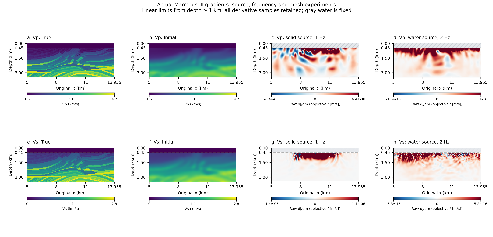
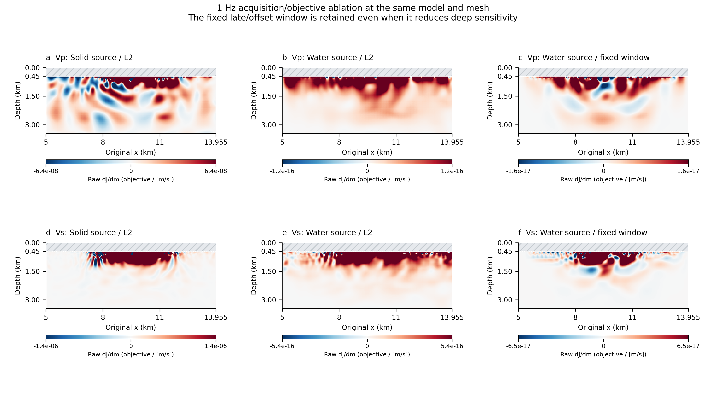

# Seeing more of Marmousi-II in the gradient

The original 1 Hz experiment verifies a discrete derivative. It was not
designed to resolve the thin Marmousi-II beds. Its Vp/Vs/density gradients
concentrate 99.95% / 99.996% / 99.98% of their squared norms above 1 km.
Changing a color map cannot supply missing frequencies or illumination.



These panels use actual native derivatives. The true and initial model panels
are separate reference inputs; their texture is never inserted into a gradient.
The same prepared 78×200 model and sigma = 150 m initial smoothing are retained.
Water remains acoustic and fixed; the active solid Vp/Vs/density grid stays
67×200. There is no change to the native numerical kernels or adjoint module.

| Quantity | Original validation | Water-source control | Higher-frequency example |
|---|---|---|---|
| Source | Vertical force in solid, depth 540 m | Gaussian acoustic potential in water, depth 150 m | Same water source |
| Receiver data | 41 solid stations, UX/UZ, depth 540 m | Same | Same |
| Source frequency | 1 Hz | 1 Hz | 2 Hz |
| Elements | 128×56 | 128×56 | 192×84 |
| DT / steps / total duration | 0.75 ms / 8000 / 6 s | Same | 0.5 ms / 12000 / 6 s |
| Source time offset / native data window | 1.2 s / −1.2…4.79925 s | Same | 0.6 s / −0.6…5.3995 s |
| Initial-model smoothing | 150 m | Same arrays | Same arrays |
| Outer boundaries | Reflecting/free native verification box | Same | Same |
| Production route | Native forward → data AD → native adjoint | Same | Same |

Source factors with the same numeric value have different physical meanings
for an elastic force and an acoustic potential source. The examples therefore
do not compare loss values or gradient amplitudes as an improvement score.
Squared-norm fractions refer to a single parameter coordinate system and are
scale-invariant diagnostics, not mechanical energy or inversion accuracy.
Late responses can include outer-boundary reflections. The new texture is a
derivative of this declared finite-box problem, rather than an isolated image
of true geological interfaces or an absorbing-boundary production FWI result.

## What changing the source actually did

| Fraction of each raw solid gradient's squared norm below 1 km | Vp | Vs | Density |
|---|---:|---:|---:|
| Solid source, 1 Hz | 0.0474% | 0.0040% | 0.0216% |
| Water source, 1 Hz, L2 | 6.777% | 0.7515% | 2.2376% |
| Water source, 1 Hz, fixed late/offset window | 4.704% | 0.2449% | 3.767% |
| Water source, 2 Hz, L2 | 9.20% | 12.83% | 18.83% |

The 1 Hz source move improves deeper sensitivity, but does not increase the
effective bandwidth. The late/offset window is not uniformly helpful: it
reduces the deep fractions for Vp and Vs while increasing density's fraction.
We retain this negative result rather than presenting weighting as a general
solution.



The 2 Hz experiment checks the native source/mesh guidance for both models
before recording history. The actual maximum suggested frequencies are
2.66818 Hz for the initial model and 2.20171 Hz for the true model; the actual
2 Hz source and 0.5 ms time step satisfy the guides. The residual's 90% temporal
energy frequency changes from 1.5 Hz in the old solid-source case to 2.833 Hz
in the new 2 Hz water-source case. This is an actual bandwidth change, not a
sharpening filter applied to the gradient.

## What the figures mean

The main plots show raw Euclidean input-coordinate derivatives with a linear,
symmetric display range. The range is the 99th percentile of the absolute
derivative at solid input samples deeper than 1 km. **Every derivative sample
is still drawn**; source/near-surface peaks can saturate. Exact limits and
saturated fractions are in the figure manifest. This is display saturation,
not gradient clipping in an optimizer. The earlier full-range/signed-log
plates and all original numerical evidence remain available.

No derivative smoothing, depth gain, illumination correction, high-pass image
filter or fitted scaling is used. Gray/hatching denotes fixed water outside
the solid parameter coordinates. The first solid sample is at 495 m; its
derivative includes the native one-sided extension to the 450 m seafloor.

A gradient is a derivative at the starting model, not a recovered geological
model. In a linearized view it is a Hessian-weighted perturbation image; finite
bandwidth, aperture and parameter coupling remain. Constant true density also
means that a density gradient is not a density image. These cases do not claim
continuum convergence, a completed FWI result or complete thin-bed resolution.

## Correctness and reproduction

The 1 Hz water case retains bitwise original-native forward agreement. Its
two-epsilon model-dot relative errors decrease from 1.38×10⁻⁶ to 1.53×10⁻⁷
for L2 and from 6.61×10⁻⁷ to 7.35×10⁻⁸ for the fixed-window objective. A
separate relative-error gate prevents small physical amplitudes from passing
on absolute tolerance alone. Independent raw coefficient/material-map and
data-cotangent checks are also retained.

The 2 Hz case: bitwise original-native forward agreement and an informative mixed model-dot test at both declared steps, with relative errors 6.46×10⁻⁶ and 7.18×10⁻⁷. The independent raw coefficient/material VJP check agrees to about 1.3×10⁻¹⁶. These are fixed-discretization directional checks, not a full new six-step parameter-family suite.

```bash
python scripts/experiment_gradient_detail_psv.py analyze
# Each pilot refuses to overwrite its result namespace.
python scripts/experiment_gradient_detail_psv.py pilot \
  --case-name my_water1 --output evidence/my_water1
python scripts/experiment_gradient_detail_psv.py pilot \
  --case-name my_water2 --output evidence/my_water2 \
  --frequency 2 --nx 192 --nz-solid 72 --nz-water 12 --dt .0005 \
  --duration 6 --losses l2 --max-history-gb 160
python scripts/plot_gradient_detail.py \
  --water1 evidence/my_water1/public \
  --best evidence/my_water2/public
```

For a render from the checked-in compact evidence instead, use
`--water1 evidence/psv_gradient_detail_water1 --best evidence/psv_gradient_detail_water2`.
The plots also require the locally prepared model inputs and the original
1 Hz validation evidence described in [VISUAL_REPORT.md](VISUAL_REPORT.md).

See [baseline diagnostics](evidence/gradient_detail_baseline_audit.json),
[water-source pilot](evidence/psv_gradient_detail_water1/pilot.json),
[higher-frequency pilot](evidence/psv_gradient_detail_water2/pilot.json) and
[display/source manifest](figures/gradient_detail/manifest.json).
The independent [figure review](figures/gradient_detail/qa/visual_qa.json)
checks the actual exported PDFs and every panel at the report's display size.
The new experiments keep the declared full-history storage policy; it is
temporary disk storage, not an optimal-memory claim. Large native fields and
private model inputs stay outside the public compact evidence bundles.
