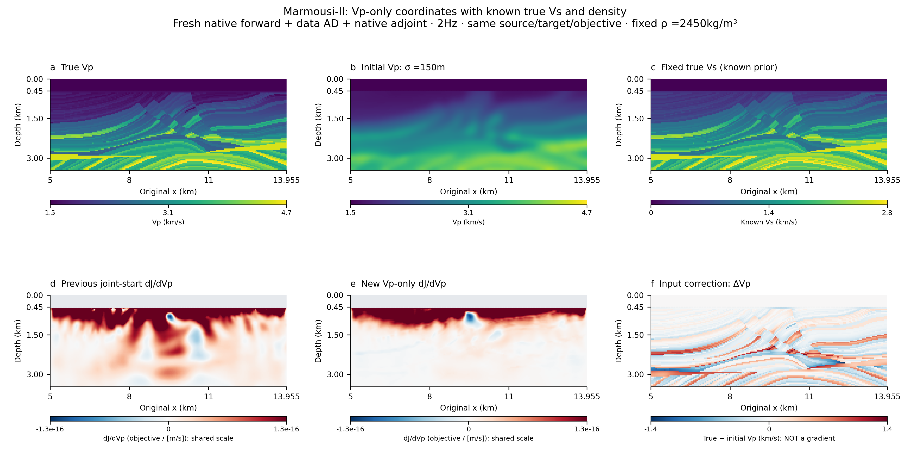
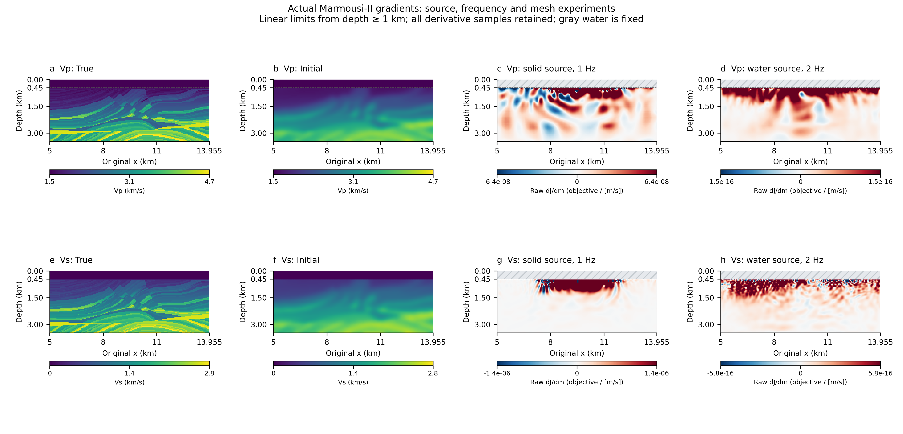
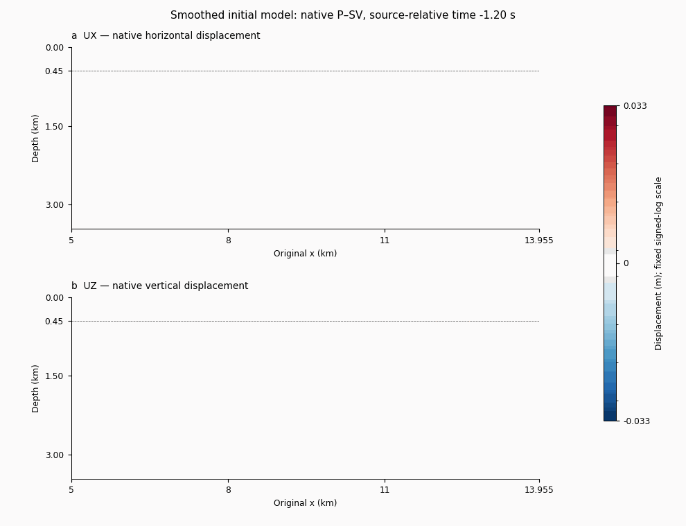
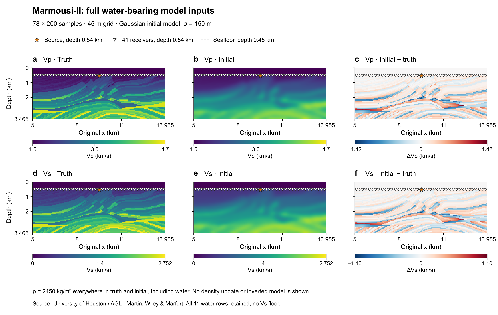
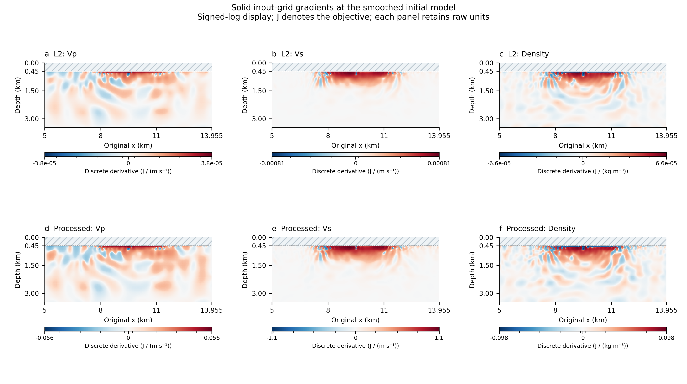
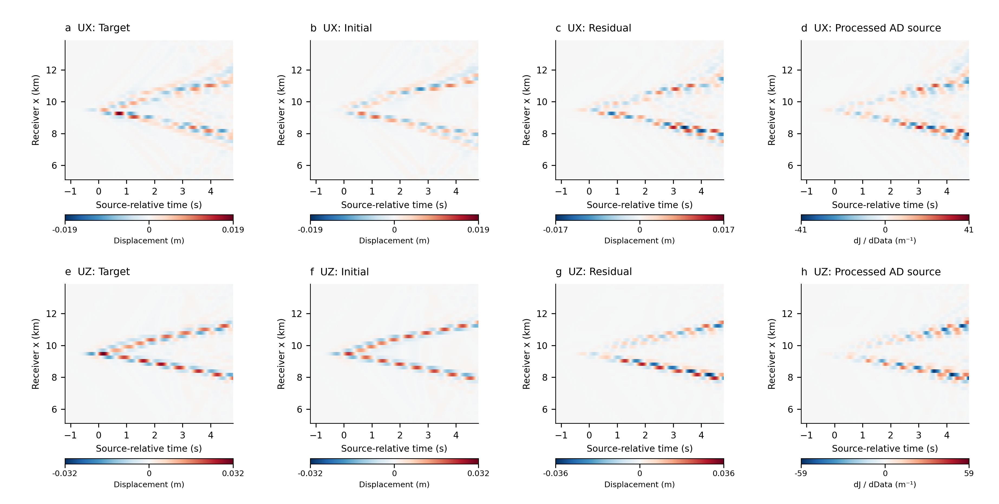
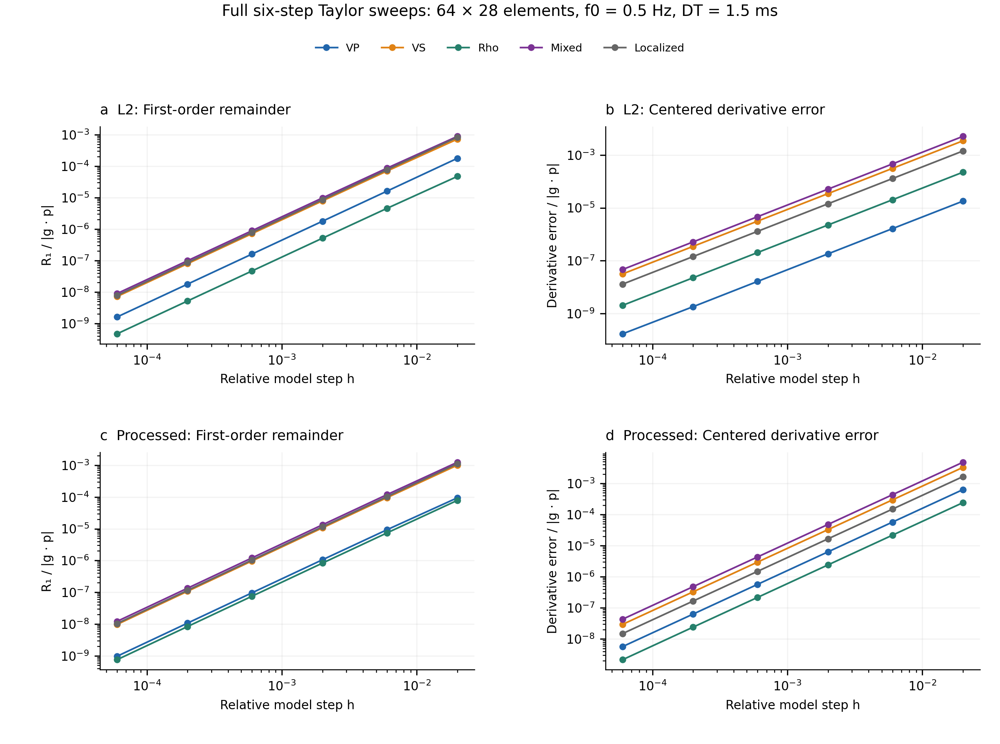

# DiffSPECFEM

**Native SPECFEM2D → differentiable inversion, demonstrated with coupled P–SV
on the full water-bearing Marmousi-II model.** By Sid.

PyTorch differentiates the data objective to obtain an adjoint source. The
existing compiled solver propagates the forward and adjoint wavefields;
its numerical kernels and MPI execution remain native. Production gradients
use **one native forward, one native adjoint, zero temporal AD and zero model
finite differences**.

This extension starts from a clean **official SPECFEM2D** checkout, pinned to
[`abf3196`](https://github.com/SPECFEM/specfem2d/tree/abf3196e3192af3343f2b402c82f34205577e672),
using the frozen generic
[differentiate-seismic-solver skill](https://github.com/Wangxi404/SeismicDiffSkill).
It did **not** use an earlier private DiffSpecfem implementation. Source,
patches, original-binary hashes, failures and repairs are recorded in
[the P–SV application record](psv_application_record.json).

## Models, wavefields and gradients

**Full-shot Vp inversion is now runnable.** Each iteration evaluates all five
independent shots at one current model, accumulates their derivatives and
accepts one update after full-shot line search. The new Marmousi-II ROI has
separate 2/4 Hz stages and known Vs/density priors. The canonical V2 optimizer
preserves small natural L-BFGS steps while capping large physical changes.
See the
[protocol and output table](FULL_SHOT_FWI.md),
[figure contract](FULL_SHOT_FIGURES.md) and
[independent numerical/control-flow audits](evidence/multishot_fwi_independent_review/).

**New: Vp-only with known true Vs.** Vp alone is blurred; a fresh native
forward, data AD VJP and adjoint pass informative Vp directional checks at two
step sizes (relative errors 5.96e−6 and 6.62e−7). The explicit material-policy
opt-in admits negative lambda only with positive bulk/shear moduli; native
update kernels and binaries are unchanged.

[](VP_ONLY.md)

The shared-scale comparison **does not show improved deep Vp detail**. Its
below 1 km squared-gradient fraction drops from 9.20% to 3.42%; the lower data
misfit is not a recovered model. See [inputs, numerical audits and replay](VP_ONLY.md).

**New: gradient-detail experiments.** Moving the source into fixed water and
using 2 Hz on a 192×84 mesh increases deeper sensitivity while retaining the
same Marmousi-II inputs and sigma = 150 m starting model. The linear display
and its saturation limits are explicit; no gradient sharpening is used.

[](GRADIENT_DETAIL.md)

[Read the parameter choices, negative window result and numerical checks](GRADIENT_DETAIL.md).
The original 1 Hz verification gallery and its separate configuration follow.

The main example is **P–SV, including native water–solid coupling**, and records
both UX and UZ. The animation uses actual native displacement in both phases
at the **smoothed initial model**, with a fixed color scale.



| True model → smoothed initial model | Spatial Vp / Vs / density gradients |
|---|---|
| [](figures/marmousi2/models_full_psv.pdf) | [](figures/marmousi2/04_psv_gradients.pdf) |
| Full 78×200 input grid; all water samples retained; sigma = 150 m. | Raw derivatives at the initial model; fixed water hatched; no gradient smoothing. |
| **Data → AD adjoint source** | **Numerical verification** |
| [](figures/marmousi2/03_psv_data_adjoint_source.pdf) | [](figures/marmousi2/05_psv_verification.pdf) |
| Both in-plane components, all 41 receivers and native time samples. | Both objectives, five perturbation families and all six step sizes on the separately declared correctness case. |

[Full visual report](VISUAL_REPORT.md) · [Native wavefield plate](figures/marmousi2/02_psv_wavefields.pdf) ·
[Method and reproduction](PSV_REPORT.md) · [Legacy SH regressions](SH_REGRESSION.md)

## What is verified

| Configuration | Full-domain correctness | Finer native demonstration |
|---|---:|---:|
| Spectral elements | 64×28 | 128×56 |
| Prepared material inputs | 78×200, 45 m | Same arrays |
| Active solid input coordinates | 3×67×200 | Same coordinates |
| MPI ranks / threads per rank | 2 / 1 | 2 / 1 |
| Native steps / DT | 4000 / 1.5 ms | 8000 / 0.75 ms |
| Total step duration / source f0 | 6 s / 0.5 Hz | 6 s / 1 Hz |
| Original-native vs extended traces | Bitwise identical | Bitwise identical |
| Complete six-epsilon Taylor sweeps | Vp, Vs, density, mixed, localized; both objectives | Separately bounded directional checks |
| Model-dot relative error, L2 / processed | 1.36×10⁻⁸ / 1.72×10⁻⁸ | 4.08×10⁻⁸ / 5.09×10⁻⁸ |
| Complete fluid–solid interface | 64 edges, 8955 m | 128 edges, 8955 m |

The finer case uses a different source frequency and time window. These are
two fixed-discretization derivative examples, not a mesh-convergence study or
an FD-versus-SEM waveform comparison. Water coefficients, sources, geometry,
time steps and free/reflecting boundaries are fixed; the three **solid** material
fields are active. Attenuation, PML/Stacey absorption, anisotropy, GPU,
active water/source/geometry and acoustic receivers are outside this interface.

Production storage is the declared full six-field native history on disk,
read one frame at a time during reversal. It is not an optimal-storage claim;
disk I/O and visualization capture have overhead. Exact phase timings and
history sizes are retained without claiming a speedup against temporal AD.

The earlier v0.2.0 release covered **SH only**. SPECFEM2D itself supports both
SH and P–SV; the current P–SV extension has its own native module, explicit
patch and validation. Original SH results and tags remain available in
[SH_REGRESSION.md](SH_REGRESSION.md) and [SH_VISUAL_REPORT.md](SH_VISUAL_REPORT.md).

## Run it

Linux, GCC/Gfortran and OpenMPI are required for native propagation:

```bash
python -m pip install -r requirements-marmousi.txt
bash scripts/build_psv.sh
python scripts/prepare_marmousi.py --mode full-psv
OMP_NUM_THREADS=1 MKL_NUM_THREADS=1 OPENBLAS_NUM_THREADS=1 python scripts/validate_psv.py \
  --model data/prepared/marmousi2_full_psv_solid_domain.npz \
  --case examples/psv_marmousi2_validation64 --evidence evidence/my_marmousi64
```

A small analytic coupled fixture requires no third-party model. The complete
commands, arbitrary differentiable objective example and parameter VJP are in
[PSV_REPORT.md](PSV_REPORT.md). Numerical tests use native model perturbations
only as independent checks; they never supply production gradients.

To redraw the published native plots without running propagation:

```bash
python -m pip install -r requirements-visualization.txt
python scripts/visualize_psv_marmousi.py \
  --evidence evidence/psv_marmousi128 \
  --correctness evidence/psv_marmousi64/validation.json
# Model-input plate additionally requires the locally prepared AGL inputs:
python scripts/visualize_marmousi_models.py
```

Marmousi-II inputs are obtained from the
[University of Houston / AGL](https://www.agl.uh.edu/downloads/downloads.htm).
The preparation recipe verifies source hashes and preserves attribution.
Third-party model arrays are not redistributed or relicensed here; public
bundles contain numerical results and their provenance. New extension code
is copyright 2026 Sid, **GPL-3.0-or-later**; upstream SPECFEM2D notices and the
bundled figure helper's Apache-2.0 license are retained in [NOTICE](NOTICE).
