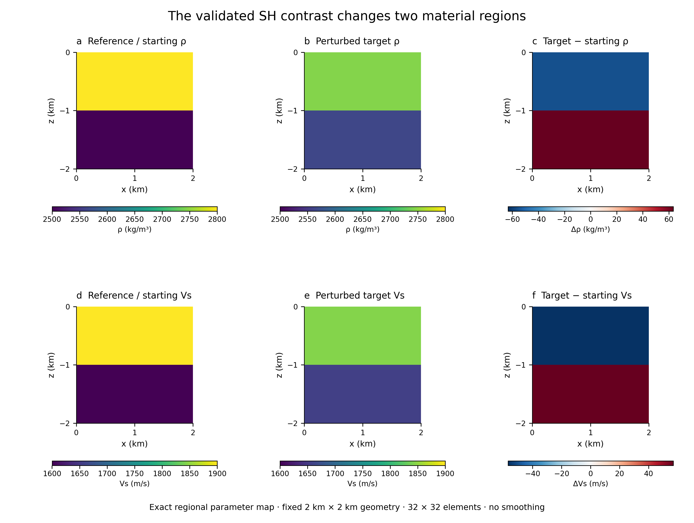
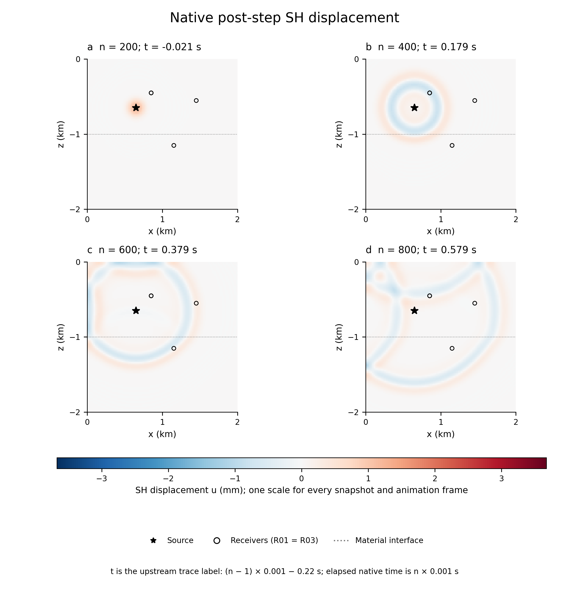
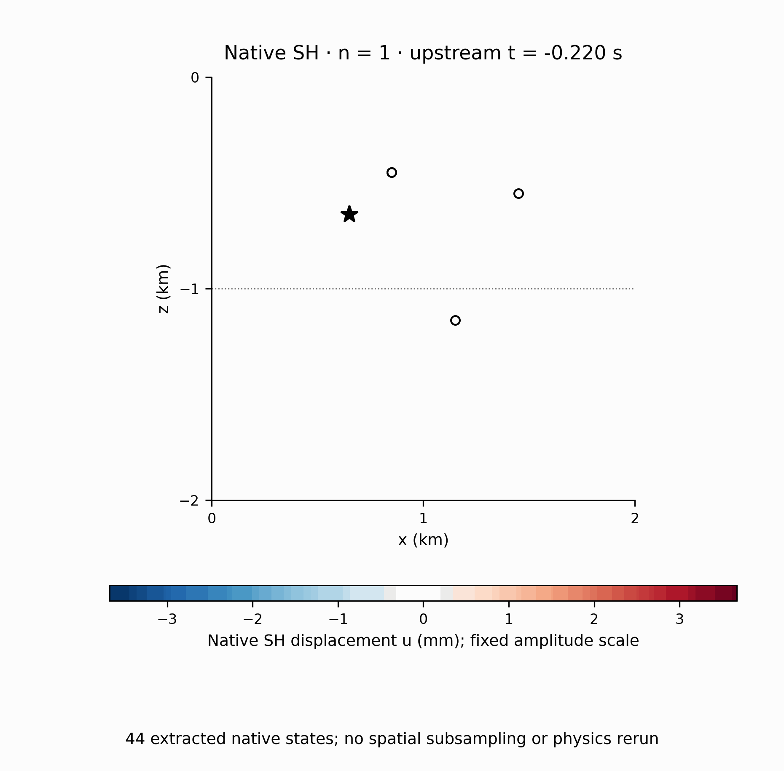
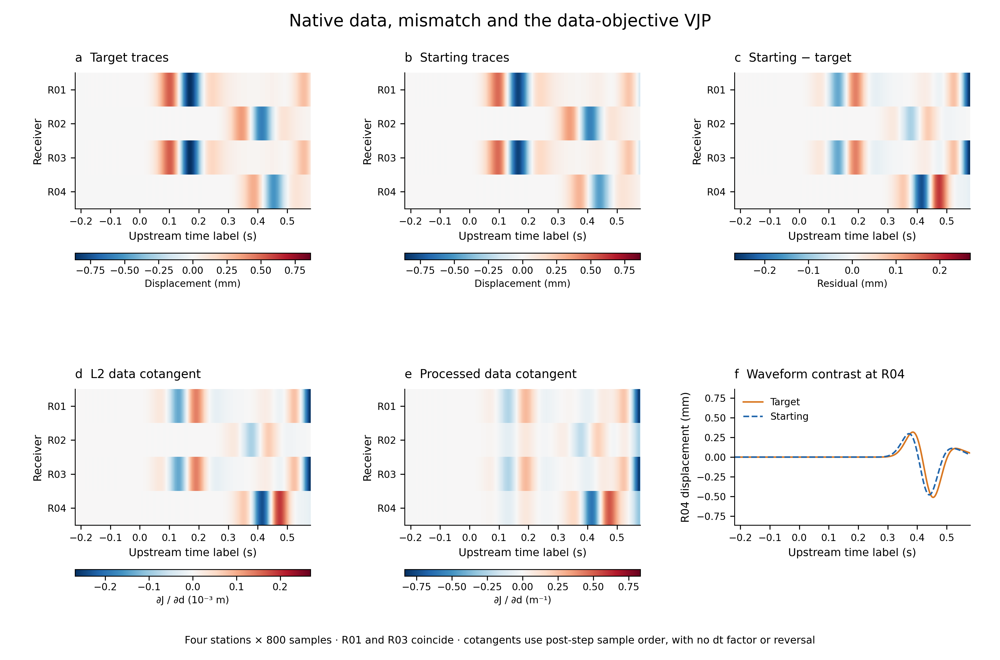
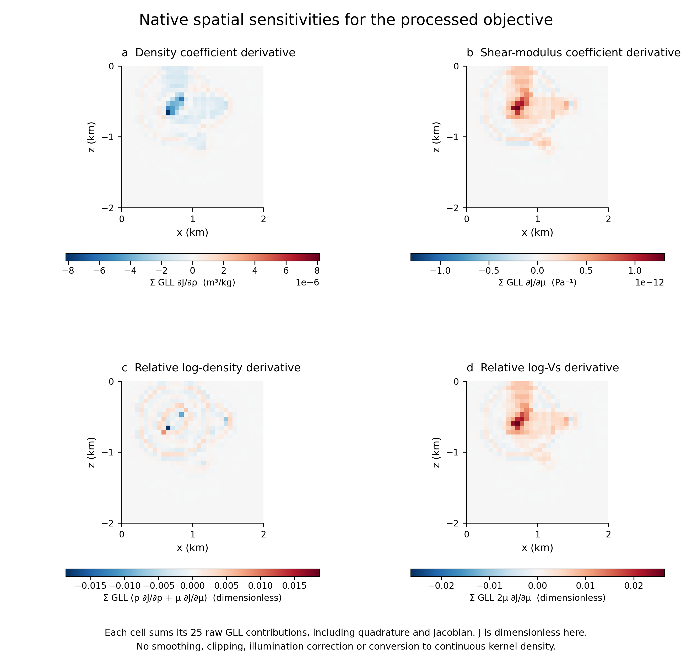
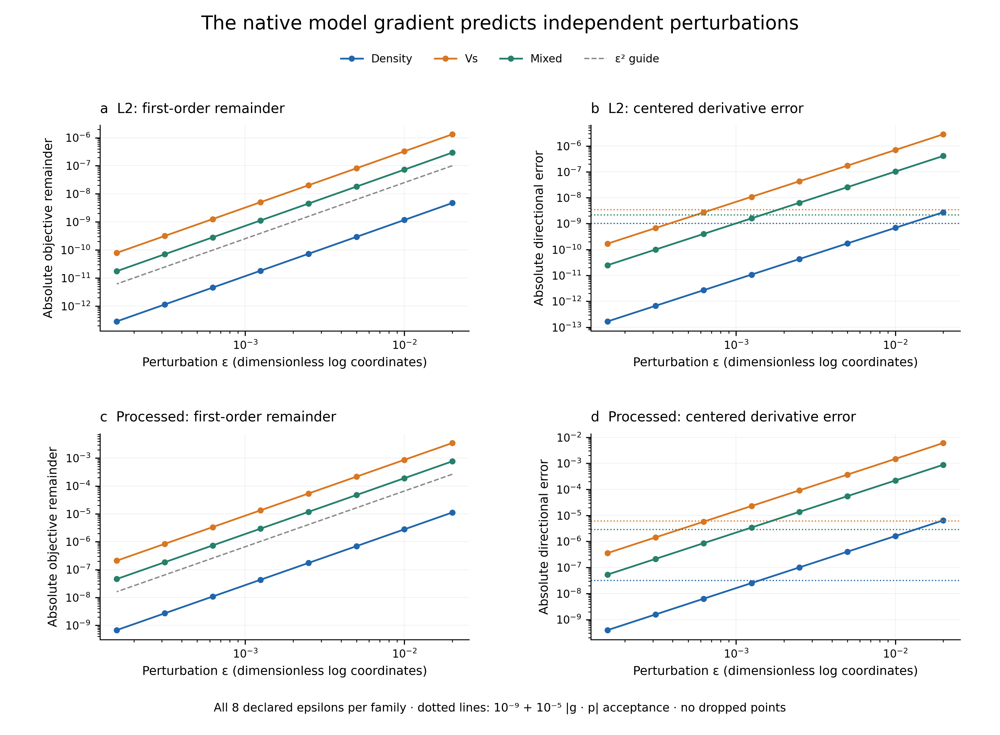

# Native SH visual evidence

Five figure plates and a wavefield animation make the numerical contract
inspectable. They use the accepted 32×32-element, two-rank SH validation case,
with 16,641 unique physical GLL nodes, four displacement receivers, 800 native
steps at 0.001 s and a 6 Hz force source. The original numerical evidence and
solver code are unchanged. The [figure contract](figures/FIGURE_CONTRACT.md)
states the claim and role of each panel before plotting.

## Actual starting and target models



**Figure 1.** The starting model is the actual heterogeneous two-layer reference.
The target uses relative log coordinates `[.025, −.02, .035, −.03]`, ordered as
bottom/top log density followed by bottom/top log Vs. Reference and target share
color limits within each physical variable; differences use symmetric limits.
The maps show all 1,024 native elements across the full physical square.

| Region; physical z | Starting ρ (kg/m³) | Target ρ (kg/m³) | Starting Vs (m/s) | Target Vs (m/s) |
|---|---:|---:|---:|---:|
| Bottom; −2 to −1 km | 2500 | 2563.288 | 1600 | 1656.992 |
| Top; −1 to 0 km | 2800 | 2744.556 | 1900 | 1843.847 |

These are exact regional parameter maps, without smoothing. A Gaussian-blurred
full-field starting model would require a different supported parameter map;
the advertised interface has four regional coordinates.

## Actual native wave propagation





**Figure 2 and animation.** These are displacement states saved by the compiled
native solver at the reference/starting model used for the L2 and processed
gradient evaluations. The star marks `(650, −650) m`; the circles mark all
receiver positions, with R01 and R03 coincident. The material interface is at
`z = −1000 m`. All natural reflecting/free boundaries and the complete domain
remain visible. Every panel and animation frame uses ±3.671960 mm, the maximum
absolute displacement over the extracted states; there is no amplitude clipping
or framewise normalization.

| Snapshot native n | Elapsed native time n·DT (s) | Upstream trace time label (s) |
|---|---:|---:|
| 200 | 0.200 | −0.021 |
| 400 | 0.400 | 0.179 |
| 600 | 0.600 | 0.379 |
| 800 | 0.800 | 0.579 |

The animation retains zero-based native indices
`union(range(0,800,20), [199,399,599,799])`: 44 actual states, shown at ten display
frames per second. Playback speed is illustrative and the spacing is not exactly
uniform after adding the four snapshots. Each title gives the real native step
and time. Both displacement and acceleration are retained in the compact source
NPZ; only displacement is visualized. No new propagation was run.

The two full histories total 214,860,824 bytes. Their SHA256 values exactly match
the previously recorded validation manifests. The extraction retains all 8,393
local nodes per rank. There are 145 duplicated MPI interface nodes; copies merge
only after exact coordinate matching, bitwise agreement of all 44 displacement
and acceleration states and verification of native interface multiplicities.
The final display uses all 129×129 unique physical nodes with nearest-cell
coloring, without interpolation or spatial subsampling. Display coordinates
are rounded by at most 6.83×10⁻¹³ m to remove native rectilinear-axis roundoff;
this does not merge any additional nodes or change field amplitudes.

Reapplying the saved native receiver interpolation weights to the selected
states reproduces the saved traces exactly in this extraction. The independent
full-history validation previously reported relative L2 error 1.568×10⁻¹⁶.

## Native data and the AD adjoint source



**Figure 3.** Target and reference predictions share one displacement scale;
the residual and L2 cotangent share one scaled numerical range. Every heatmap
contains all four receivers and all 800 samples. R01 and R03 deliberately remain
duplicated. The trace detail shows R04 over the complete record rather than a
selected arrival window. The native source of the adjoint is the transpose
receiver interpolation applied to the data cotangent at that same post-step
state, with no implicit `dt`, sign reversal, array reversal or force scaling.

| Objective | Definition / data processing | J units | Data cotangent units |
|---|---|---|---|
| L2 | `0.5·sum((d−target)²)` | m² | m |
| Processed | Fixed FIR → `tanh(d/0.02 m)` → receiver mixing → weighted L2 | Dimensionless | m⁻¹ |

The processed objective includes the FIR, nonlinearity, mixing and time weights
defined in `diffspecfem/adapter.py`; the plotted cotangent comes directly from
its PyTorch data VJP. The L2 cotangent is asserted to equal the raw residual.
The wavefield histories are native Fortran output, not an AD wave solver.

## Native spatial coefficient gradients



**Figure 4.** For the processed objective, each cell is the sum of that spectral
element’s 25 raw GLL coefficient contributions. The upper maps differentiate
the native density and shear-modulus coefficients; the lower maps apply the
exact chain rule for `μ = ρ·Vs²`. They are already discrete derivatives including
SEM spatial quadrature and geometric Jacobian. They are not continuous kernel
densities or unweighted nodal point values. No smoothing, normalization,
illumination correction, clipping or fitted scale is applied. Each distinct
variable uses its own symmetric color range, with its units shown.

| Regional processed coordinate | Sum of the mapped native elements |
|---|---:|
| Bottom log ρ | 0.00431406502728369 |
| Top log ρ | −0.0000339590872904250 |
| Bottom log Vs | 0.0372220584151394 |
| Top log Vs | 0.793774548291274 |

The spatial maps sum to the independently saved four-coordinate gradient with
maximum absolute difference 2.22×10⁻¹⁶. Element boundaries retain the regional
material discontinuity; no overlapping interface GLL values are averaged into a
false pointwise gradient field.

## Independent derivative evidence and its limits



**Figure 5.** Both objectives use all eight declared epsilons, separately for
density, Vs and a mixed direction. The first-order objective remainder is
`|J(m+εp) − J(m) − ε g·p|`. The centered error is
`|(J(m+εp) − J(m−εp))/(2ε) − g·p|`. The ε² guide is explicitly scaled only as a
visual order reference, never fitted into the gradient. Dotted thresholds are
the actual `10⁻⁹ + 10⁻⁵ |g·p|` central-derivative tolerance. Larger epsilons that
do not meet that threshold remain visible.

| Evidence | 8×8, 2 ranks | 32×32, 2 ranks |
|---|---:|---:|
| Unique physical nodes | 1,089 | 16,641 |
| Actual source f0 | 6 Hz | 6 Hz |
| Native recommended maximum f0 | 2.048 Hz | 8.192 Hz |
| Native recommendation met | No | Yes |
| L2 model-dot relative error | 6.436×10⁻¹⁰ | 1.113×10⁻⁹ |
| Processed model-dot relative error | 7.183×10⁻¹⁰ | 1.215×10⁻⁹ |
| L2 / processed model Taylor checks | Pass | Pass |
| Original-native / extension traces | Bitwise identical | Bitwise identical |

The coarse case establishes differentiation of its fixed discrete solver but
underresolves the high-frequency tail under native source guidance. Refinement
does not make this a grid-convergence study. The original failed serial Taylor
sweep remains in `evidence/validation-attempt1.json`: its first epsilon range
gave only one central match. Smaller epsilons were appended, with no discarded
points and no tolerance relaxation. The strengthened native sampling probe and
test-only history comparison repair remain in `REPORT.md` and the application
record. The visual additions do not alter those records.

## Reproduce and audit

```bash
python scripts/visualize_evidence.py
```

The renderer needs NumPy, matplotlib and Pillow. Its mandatory alignment gate
uses the [bundled helper](scripts/figure_qa/README.md), with its original Apache
license and upstream attribution, so no installed skill is required. The source
NPZ is included, so local rendering needs no remote machine, native build or
benchmark run. `extract_native_frames.py` documents how the source frames were
obtained and verifies original hashes. `--qa-scripts` or `NATURE_FIGURE_QA` can
override the renderer's bundled helper directory.

The independent source, final-PDF glyph and collision tools remain optional
post-export audits. Their final results are already committed. To rerun them
with an installed nature-figure scripts directory and PyMuPDF, use:

```bash
python scripts/audit_visual_evidence.py --qa-scripts /path/to/nature-figure/scripts
```

The [source manifest](evidence/visuals/manifest.json) records every input hash,
coordinates, times, extraction rule, unit convention and numerical closure.
The [source arrays](evidence/visuals/figure_source_data.npz) and
[complete Taylor rows](evidence/visuals/taylor_source_data.json) support
independent inspection. Editable PDF/SVG companions sit beside every PNG.
The [QA summary](figures/qa/summary.json) and
[panel-by-panel review](figures/qa/VISUAL_QA.md) keep audit evidence separate
from the scientific plates.
