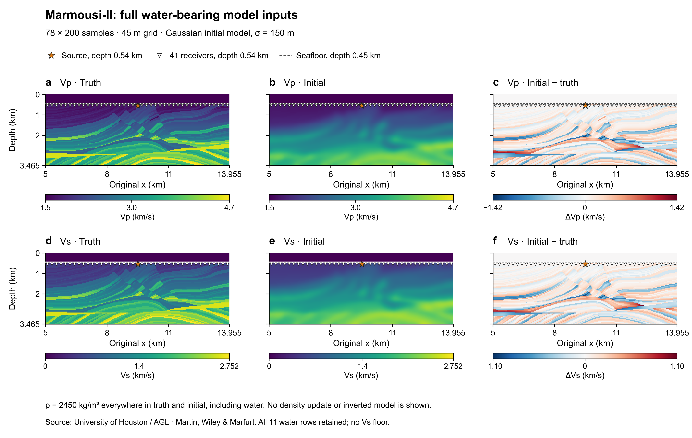
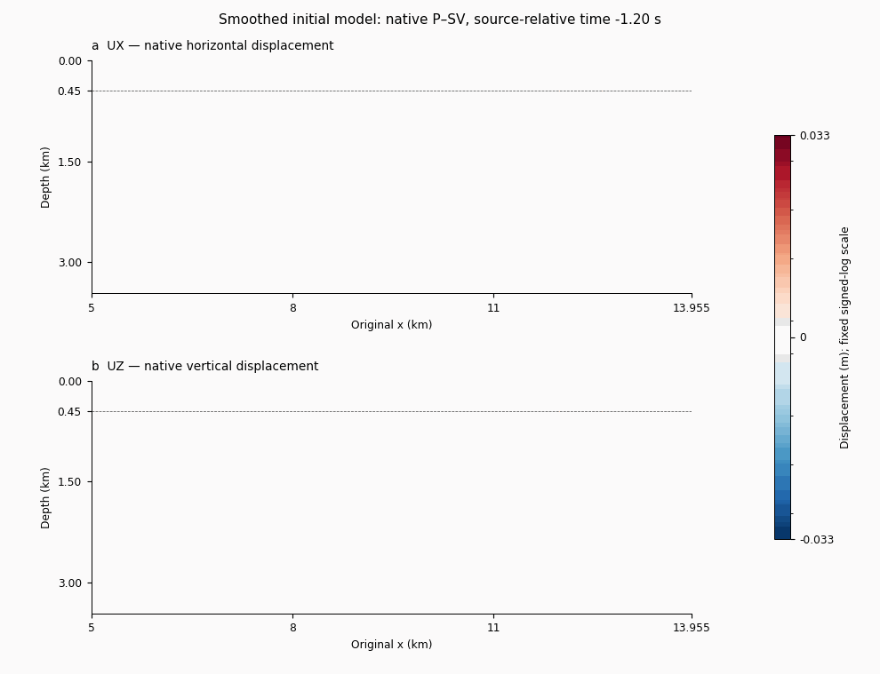
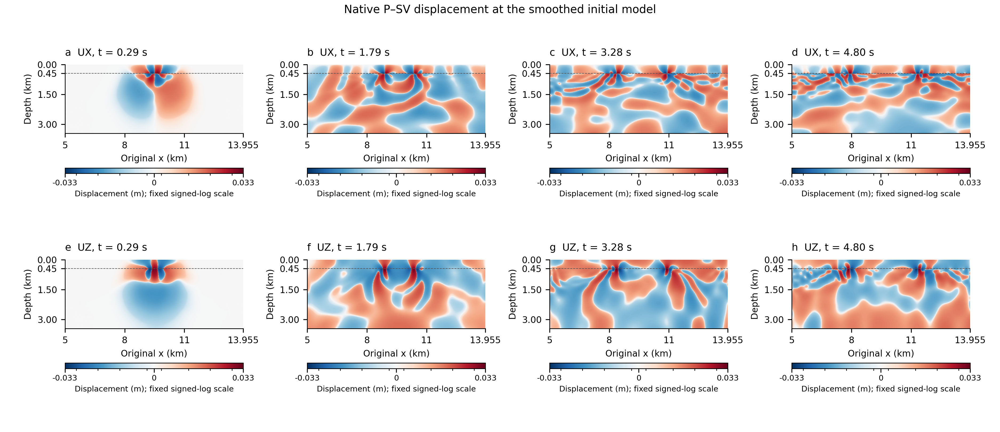
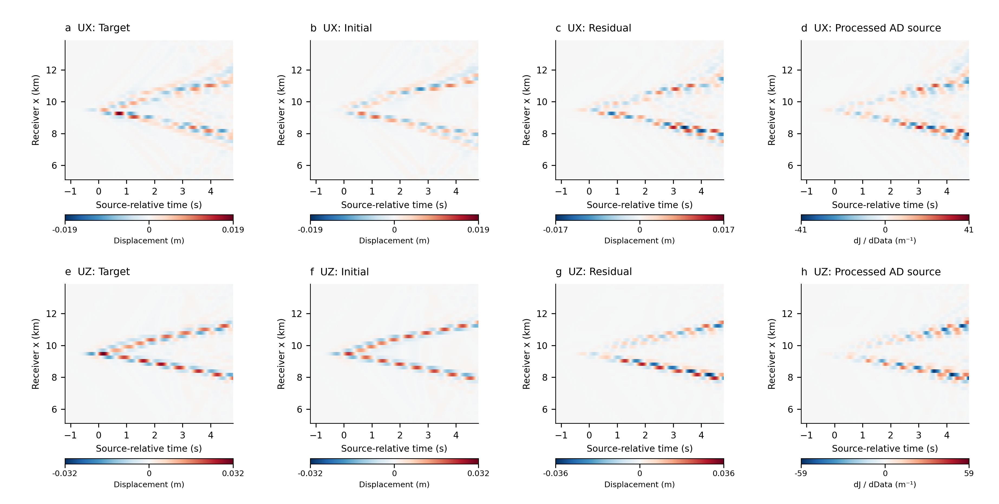
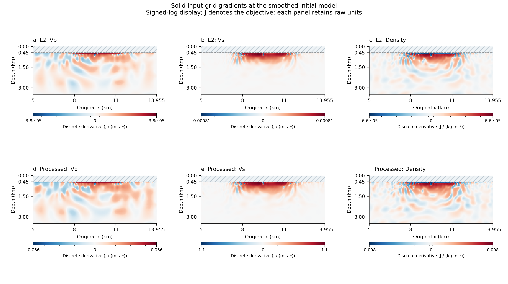
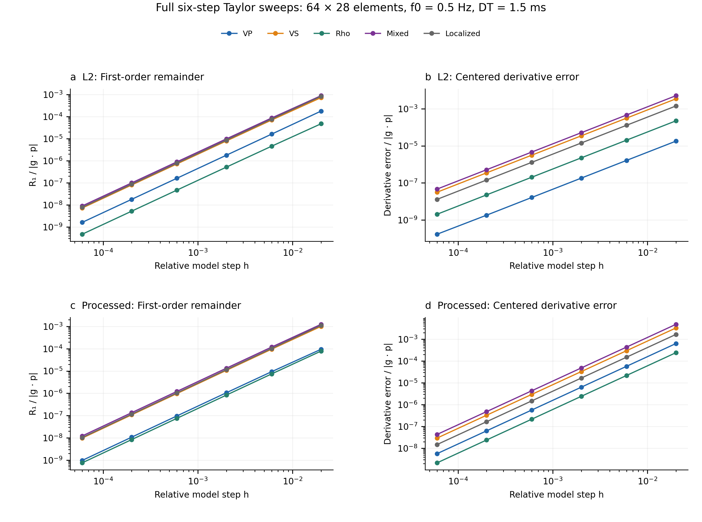

# Coupled P–SV on Marmousi-II

For the new **water-source / 2 Hz gradient-detail experiments**, see
[GRADIENT_DETAIL.md](GRADIENT_DETAIL.md). They retain the same prepared models,
use a denser native mesh, and show raw derivatives with declared linear display
limits. The original 1 Hz numerical-verification gallery below remains intact.

The main demonstration now uses **P–SV with acoustic water and elastic solid**
from the official SPECFEM2D source. Both native displacement components are
recorded. The older SH-only gallery belongs to the v0.2.0 regression and is
preserved in [SH_VISUAL_REPORT.md](SH_VISUAL_REPORT.md).

## Full model inputs



The complete 78×200, 45 m prepared Marmousi-II arrays match the HybridADFWI
comparison inputs byte-for-byte. Vp and Vs true/initial pairs share color
scales; the third column is **initial minus true**. The initial model uses
sigma = 150 m smoothing within solid, with all 11 water sample rows restored.
Density is 2450 kg/m³ everywhere in both models, including the water. These
are target and starting models; no recovered inversion model is shown.

Source and receiver positions come from the actual native case files. The
native interface is at 450 m depth. This image displays input samples as
nearest-sample cells, whose water color band ends at the 472.5 m midpoint;
the dashed 450 m line specifies the physical SEM interface. In the native
solid reader, the first positive-Vs sample at 495 m is extended one-sided to
450 m. Input samples are unchanged. This is an explicit FD/SEM representation
difference, not a water-to-rock replacement.

[PDF](figures/marmousi2/models_full_psv.pdf) · [SVG](figures/marmousi2/models_full_psv.svg) ·
[Metadata](figures/marmousi2/models_full_psv_metadata.json) ·
[Preparation and exact-input checks](evidence/marmousi2_full_psv_preparation.json)

## Actual native wavefields





These are actual native displacement fields at the **smoothed initial model**
on the 128×56 element case. The official `compute_vector_one_element` exports
elastic UX/UZ and water displacement `(1/rho) grad(chi)`. An independent small
case check reconstructs the water displacement from the saved acoustic
potential and agrees to relative error 5.13×10⁻¹⁵.

All 50 exported post-step frames, both components and all element-local
5×5 GLL points are retained. The two phases keep their own interface values;
there is no averaging across the fluid/solid interface. The fixed signed-log
color scale uses the largest absolute displacement over the **entire record
and both components**, with a linear threshold of 0.001 times that maximum.
No frame-wise normalization or saturation is applied. Gouraud color
interpolation occurs only within explicit GLL subtriangles for display.

The timestamp is the original native trace label:
`(step - 1) * DT - USER_T0`. Full post-step elapsed time is `step * DT`.
The GIF plays each saved frame for 100 ms as a screen preview; labels retain
the actual times, including the shorter last physical sampling interval.
Positive UZ is the native upward-z component; plot depth increases downward.

[Wavefield PDF](figures/marmousi2/02_psv_wavefields.pdf) ·
[Animation layout PDF](figures/marmousi2/native_psv_animation_layout.pdf) ·
[Native frame/result provenance](figures/marmousi2/native_visual_manifest.json)

## Data-domain AD



Rows are UX and UZ; columns show target data, initial-model data, residual and
the AD cotangent of the processed objective. Every receiver and every native
time sample is included. Target/initial panels share the same scale within
each component; residual and cotangent scales are explicit and separate.
The processed objective includes an FIR filter, `tanh`, receiver and component
mixing, and time-dependent weights. Its cotangent is the native adjoint source
after the actual sampling transpose. For the unprocessed L2 objective, the
data cotangent equals the residual exactly.

[PDF](figures/marmousi2/03_psv_data_adjoint_source.pdf) ·
[SVG](figures/marmousi2/03_psv_data_adjoint_source.svg)

## Spatial material derivatives



Each panel is the **raw discrete derivative** on the 67×200 active solid input
grid, after the physical Vp/Vs/density chain rule and native interpolation
transpose. Rows show L2 and processed objectives. These are gradients at the
smoothed initial model, using observations from the true model. Water is fixed
and hatched; it is outside the active model coordinates. The top solid sample
is at 495 m; its derivative includes the native 450…495 m border extension.
The plotted values are input-coordinate derivatives, not a continuum kernel
density with identical units at every spatial sampling density.

Signed-log display uses a linear threshold of 0.001 times each panel's raw
absolute maximum. Scales are independent and labeled per parameter/objective.
There is **no gradient smoothing, illumination division, normalization,
clipping or fitted scale**. In unit labels, J means the objective, not joules:
L2 has displacement-squared units; the processed objective is dimensionless.

[PDF](figures/marmousi2/04_psv_gradients.pdf) ·
[SVG](figures/marmousi2/04_psv_gradients.svg)

## Verification and configuration



The full six-epsilon Taylor figure comes from the **64×28 full-domain
correctness case**, with f0 = 0.5 Hz and DT = 1.5 ms. All five parameter
families—Vp, Vs, density, mixed and localized—and both objectives are shown.
The first-order remainders and centered derivative errors are divided by
their own nonzero `|g · p|` for display only. Every epsilon remains in the
plot and raw report. Acceptance requires observable second-order intervals,
nonzero directional slopes and consecutive centered-derivative agreement.

The finer **128×56** demonstration uses the same prepared model inputs with
f0 = 1 Hz and DT = 0.75 ms. It separately checks the native forward, material
map, sampling, coupling, data VJP and mixed/localized model directions.
Its directional checks do not replace or masquerade as the full six-step
suite. The configurations differ in both mesh and source/time window; this
is not a grid-convergence experiment.

| Quantity | Correctness case | Finer demonstration |
|---|---:|---:|
| Elements, solid + water rows | 64×(24+4) | 128×(48+8) |
| Native steps / DT | 4000 / 1.5 ms | 8000 / 0.75 ms |
| Elapsed step duration | 6 s | 6 s |
| Source f0 / USER_T0 | 0.5 Hz / 2.4 s | 1 Hz / 1.2 s |
| Native trace-label window | −2.4…3.5985 s | −1.2…4.79925 s |
| MPI ranks / threads | 2 / 1 | 2 / 1 |
| Native source guidance, initial / true | 0.88954 / 0.74085 Hz | 1.77885 / 1.45340 Hz |
| Original-native vs extension data | Bitwise equal | Bitwise identical |
| Model-dot relative error, L2 / processed | 1.36×10⁻⁸ / 1.72×10⁻⁸ | 4.08×10⁻⁸ / 5.09×10⁻⁸ |
| Interface edges / total length | 64 / 8955 m | 128 edges, 8955 m |

[64×28 raw validation](evidence/psv_marmousi64/validation.json) ·
[128×56 raw validation](evidence/psv_marmousi128/validation.json) ·
[Small coupled fixture](evidence/psv_unit/validation.json) ·
[Independent audits](evidence/psv_independent_audit.md)

The native numerical kernels and forward updates are unchanged; the exact
source patch is [native/psv_iterate_time.patch](native/psv_iterate_time.patch).
Full history is written to disk and read one frame at a time in reverse.
The 128×56 six-field history totals **44,412,672,024 bytes** across both ranks.
This is a declared full-history policy, not a minimum-storage or speedup
claim. Actual launch/resource logs include recording and adjoint phases;
history hashing, evidence packaging and figure rendering are separate work.
The full history is temporary: validation retains hashes and selected native
states before a subsequent forward evaluation replaces the work directory.

## Redraw and audit

```bash
python -m pip install -r requirements-visualization.txt
python scripts/visualize_psv_marmousi.py \
  --evidence evidence/psv_marmousi128 \
  --correctness evidence/psv_marmousi64/validation.json
python scripts/visualize_marmousi_models.py  # requires locally prepared inputs
```

All plates have PNG, editable-text PDF and SVG companions. Figure contracts,
source hashes, rendered alignment and independent glyph/collision checks are
under [figures/marmousi2](figures/marmousi2). Public result bundles retain the
actual wavefields/gradients/data but omit input model arrays and physical
perturbations that directly reconstruct those inputs. The downloadable AGL
inputs and checksum-verified preparation remain available for reproduction.
