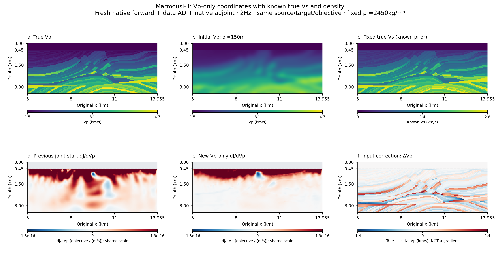

# Native P–SV Vp sensitivity with known true Vs

This controlled Marmousi-II experiment holds true Vs and the known density
field fixed, blurs only Vp, and computes a fresh Vp derivative with native
forward propagation, data-domain AD and the native discrete adjoint.



| Field | Observed-data model | Starting model | Inversion coordinate |
|---|---|---|---|
| Vp | Prepared true Vp | The existing sigma = 150 m Gaussian Vp | Vp only |
| Vs | Prepared true Vs | Exactly the same true Vs | Fixed |
| Density | Known constant 2450 kg/m³ | Exactly the same constant field | Fixed |

True Vs is a declared synthetic prior and still participates in every elastic
calculation. Density follows the existing constant-density experiment; it is
not the original Marmousi-II variable-density field. The native solver remains
coupled acoustic water and elastic P–SV, with both solid UX/UZ receivers.

The full prepared 78×200 Marmousi-II model and the 67×200 active-solid sampling
are retained. Acquisition is the existing water source at 150 m depth,
41 solid stations at 540 m, 2 Hz, a 192×84 native mesh, DT = 0.5 ms and
12000 steps. Source time offset is 0.6 s, so native records span
−0.6…5.3995 s. Outer boundaries retain the declared reflecting/free verification
box; late responses can include boundary reflections.

## Material screen and the wrapper policy

Combining independently blurred Vp with true Vs can produce negative lambda.
Positive density, positive solid shear modulus and positive bulk modulus are
checked explicitly. The original wrapper's default positive-lambda restriction
is retained; this new experiment uses an explicit opt-in material policy.
No Vp/Vs clipping is used to satisfy the old restriction.

A separate small native negative-lambda control must pass before the full
history run. Native true/initial source-frequency and time-step guidance,
material interpolation and observation agreement are then checked on the
actual experiment. Native update kernels, pinned source revision, MPI layout
and adjoint algebra are not modified by the wrapper validation policy.

The mixed initial grid contains 316 negative-lambda nodes. Minimum lambda is
−9.067 GPa, minimum 3-D bulk modulus is 1.637 GPa, and minimum plane-strain
kappa is 6.104 GPa. The minimum Vp/Vs ratio is 1.198. These checks establish
material admissibility; they do not substitute for the native time/frequency
guide or a derivative test. The official pinned native code permits negative
Poisson ratios and directly uses lambda in its elastic stress update.

The small coupled negative-lambda control passes bitwise native-forward and
data-VJP checks. Its three Vp-only finite-difference steps, 3×10⁻⁴, 10⁻⁴
and 3×10⁻⁵, give model-dot relative errors 2.24×10⁻⁶, 2.49×10⁻⁷ and
2.24×10⁻⁸, with approximately second-order convergence. Independent
coefficient-to-Vp transpose reconstruction agrees to about 1.3×10⁻¹⁶.

Earlier attempts remain separately archived: the first stopped before native
execution because of a packet-hash implementation mistake; another used a
coarser 10⁻³ step whose 2.49×10⁻⁵ truncation error exceeded the unchanged
10⁻⁵ threshold. Its failed flag was retained. A fresh finer-step contract
then passed without lowering the threshold or changing the physical model.

For the full Marmousi-II case, both the mixed initial and true models have
native maximum suggested source frequency 2.20171 Hz. Their maximum suggested
time steps are 0.83101 and 0.76922 ms, respectively. The actual 2 Hz / 0.5 ms
settings satisfy those native guides.

## A fresh single-parameter derivative

The new prediction, residual and data VJP are computed from blurred Vp plus
true Vs. The native adjoint returns coefficient sensitivities; the advertised
model-coordinate transpose selects only Vp. Auxiliary Vs/density kernel
components are not treated as inverted parameters. Directional checks perturb
Vp only while holding Vs and density exactly fixed.

The full experiment passes its predeclared strict relative 10⁻⁵ model-dot
gate at both steps. Errors decrease from 5.961×10⁻⁶ at h = 3×10⁻⁴ to
6.623×10⁻⁷ at h = 10⁻⁴, with approximately second-order convergence. The
gradient-direction dot is informative (right-hand side 4.408×10⁻¹⁰).
Independent native coefficient-to-Vp reconstruction agrees to about
1.2×10⁻¹⁶. The fresh target is bitwise identical to the earlier 2 Hz target.

| Within this same native objective | Previous blurred Vp and Vs | New blurred Vp, true Vs |
|---|---:|---:|
| Unnormalized displacement L2 objective | 8.37059×10⁻¹¹ | 1.07774×10⁻¹¹ |
| Vp squared-gradient fraction below 1 km | 9.20% | 3.42% |

The smaller loss does not produce a clearer deep Vp image in this test. With
the same old/new linear color scale, the new derivative is more concentrated
in shallow structure and remains broad. This is a negative result for the
proposed visual improvement, not a failed derivative check. Squared-gradient
fractions are not mechanical energy or inversion accuracy. The finite
frequency, aperture and single-shot illumination still bound what can be seen.

The earlier multiparameter Vp derivative is shown as a labelled control. Raw
derivatives are plotted without smoothing, depth gain, sharpening or copied
true-model structure. The input correction `true Vp - initial Vp` is explicitly
distinct from an objective derivative. Display limits and saturation are
recorded. The known true Vs makes this a controlled prior experiment, not
a blind recovery of Marmousi-II or a completed inversion.

## Reproduction and evidence

First build the pinned native P–SV binaries and prepare the original AGL
Marmousi-II inputs as described in [README.md](README.md). The frozen packet
is the unchanged `SeismicDiffSkill/releases/v0.2.0` directory.

```bash
python scripts/experiment_vponly_psv.py prepare --name my_vponly
python scripts/experiment_vponly_psv.py run --name my_vponly \
  --output evidence/my_vponly \
  --packet /path/to/SeismicDiffSkill/releases/v0.2.0 \
  --max-history-gb 160
```

Fresh names are required to preserve earlier attempts. Successful compact
outputs are written under `evidence/my_vponly/public`. The archived executed
driver and API hashes record the actual run; subsequent CLI changes only
make fresh replay namespaces selectable and do not alter the native updates.

To reproduce the negative-lambda regression, first generate the original
analytic fixture, then use a fresh unit namespace with `--unit`:

```bash
python examples/psv_coupled_unit/DATA/prepare_fixture.py
python scripts/experiment_vponly_psv.py prepare --unit --name my_negative_lambda
python scripts/experiment_vponly_psv.py run --unit --name my_negative_lambda \
  --output evidence/my_negative_lambda \
  --packet /path/to/SeismicDiffSkill/releases/v0.2.0
```

Re-render the archived full result, or substitute `evidence/my_vponly/public`
and `data/prepared/my_vponly.npz` for a new run:

```bash
python scripts/plot_vponly_psv.py \
  --evidence evidence/psv_marmousi2_20261107-vponly \
  --reference evidence/psv_gradient_detail_water2 \
  --model data/prepared/marmousi2_20261107-vponly.npz
```

See [full numerical audit](evidence/psv_marmousi2_20261107-vponly/independent_audit.json),
[small negative-lambda audit](evidence/psv_negative_lambda_20261107-vponly/independent_audit.json)
and [six-panel exported-PDF review](figures/vponly/qa/visual_qa.json).

The frozen skill packet and original cases are preserved. Numerical evidence
keeps the native baseline, the new objective/cotangent, informative Vp-only
directional checks and the explicit history policy. Temporary full native
history is streamed from disk; this is not an optimal-memory result. Public
compact evidence excludes material input arrays and large native histories.

See the earlier [source/frequency experiment](GRADIENT_DETAIL.md) for the
separate multiparameter starting model and its validation record.
